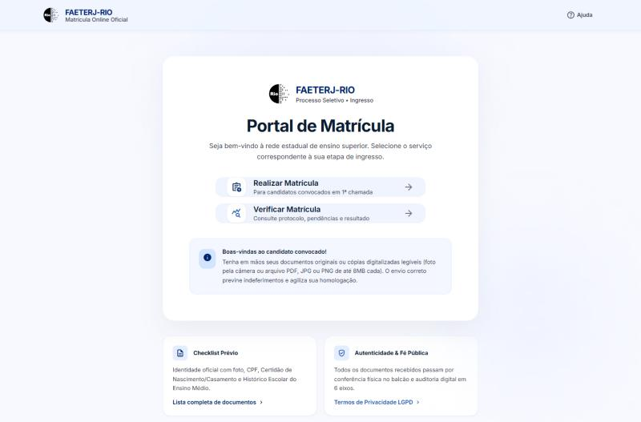
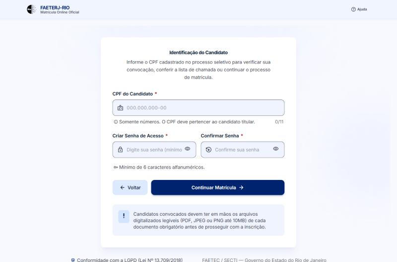
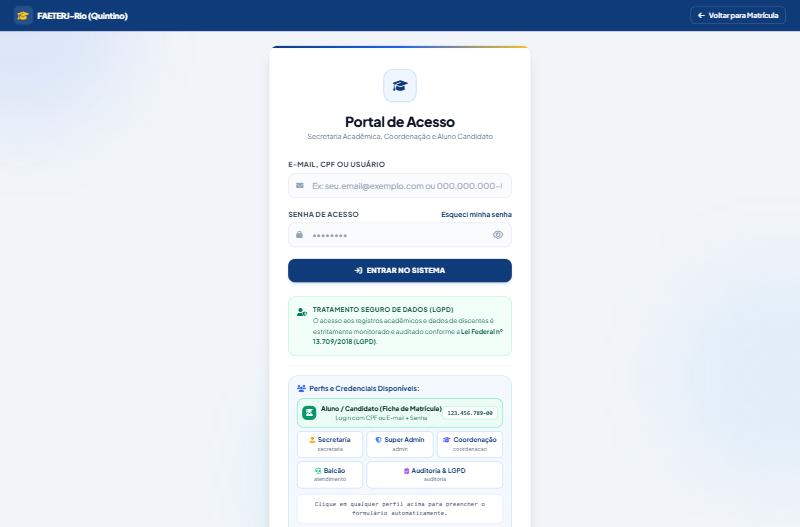
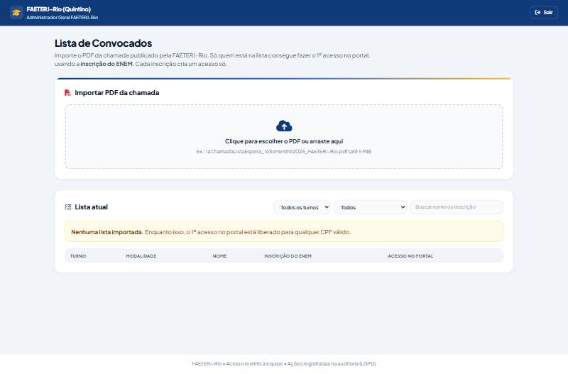

# Coruja Matrícula — Sistema de Matrícula Online

> ⚠️ **Todos os dados deste repositório são fictícios.** Nomes, CPFs, e-mails, telefones e endereços foram inventados apenas para demonstração. Este é um projeto acadêmico e não tem vínculo oficial com nenhuma instituição.

Sistema web desenvolvido como trabalho de faculdade (curso de Análise e Desenvolvimento de Sistemas) para simular a matrícula online de candidatos aprovados em uma faculdade pública e a análise desses cadastros pela secretaria acadêmica.

## O que o sistema faz

**Portal do candidato**
- Primeiro acesso com CPF e número de inscrição do ENEM (só quem está na lista de convocados consegue criar conta).
- Preenchimento da ficha de matrícula em etapas, com validação em tempo real (CPF com dígito verificador, CEP, datas, RG, título de eleitor, NIS do CadÚnico).
- Busca automática de endereço pelo CEP (ViaCEP).
- Envio dos documentos (certidão, RG, comprovante de residência, histórico escolar).
- Leitura automática dos documentos por IA (Google Gemini) para pré-preencher a ficha. Opcional.
- Comprovante de matrícula com número de protocolo para download.
- Recuperação de senha por CPF + data de nascimento.

**Área da secretaria**
- Login da equipe com perfis diferentes (administrador, secretaria, coordenação, atendimento, auditoria).
- Importação da lista de convocados a partir do PDF oficial da chamada.
- Painel para analisar, deferir ou indeferir cada matrícula.
- Auditoria automática das fichas, apontando inconsistências (idade, cotas, documentos, contatos).
- Controle do período de matrícula e dos semestres.
- Backup diário automático dos dados e log de auditoria de todas as ações.

## Tecnologias usadas

| Camada | Tecnologia |
|---|---|
| Back-end | Node.js 20+, Express |
| Front-end | HTML, JavaScript puro, Tailwind CSS, Font Awesome |
| Banco de dados | Arquivos JSON locais (com suporte opcional a PostgreSQL) |
| Segurança | JWT (sessões), bcrypt (senhas), Helmet, rate limiting, CORS |
| IA | Google Gemini (OCR de documentos, opcional) |
| PDF | pdfjs-dist (leitura da lista de convocados) |
| Testes | Test runner nativo do Node (`node --test`) |

## Prints

| Portal do candidato | Ficha de matrícula |
|---|---|
|  |  |

| Login da equipe | Lista de convocados (secretaria) |
|---|---|
|  |  |

## Como rodar o projeto

Pré-requisito: **Node.js 20 ou superior**.

```bash
git clone https://github.com/Eliseu2013/coruja-matricula.git
cd coruja-matricula
npm install
copy .env.example .env     # no Linux/Mac: cp .env.example .env
npm start
```

- Portal do candidato: http://localhost:3000
- Área da equipe: http://localhost:3000/login

Na **primeira execução** o terminal mostra, uma única vez, as senhas geradas para os perfis `admin`, `secretaria`, `coordenacao`, `atendimento` e `auditoria`. Anote. Para definir uma senha própria:

```bash
npm run definir-senha -- admin "SuaSenhaForte#2026"
```

### Variáveis de ambiente

Todas estão descritas em [`.env.example`](.env.example). As principais:

| Variável | Para que serve |
|---|---|
| `JWT_SECRET` | Segredo que assina as sessões. Obrigatório em produção. |
| `GEMINI_API_KEY` | Chave da API Gemini para a leitura automática de documentos. Opcional. |
| `APP_URL` | Endereço público do sistema (usado no CORS). |
| `DATABASE_URL` | Conexão PostgreSQL. Sem ela o sistema usa os arquivos JSON. |

Nenhuma chave ou senha fica no código.

### Testes

```bash
npm test        # 37 testes (unitários, integração e segurança)
npm run lint    # verificação de sintaxe de todos os .js
```

### Lista de convocados (opcional)

A secretaria pode importar o PDF da chamada pela tela **Lista de Convocados**. O arquivo `data/convocados.example.json` mostra o formato. Sem a lista, qualquer CPF válido consegue criar conta (modo de demonstração).

## O que eu aprendi

- Montar uma API REST com Express e organizar o código em módulos (autenticação, banco, auditoria, backup).
- Autenticação com JWT e senhas com bcrypt, incluindo controle de sessão por versão (trocar a senha derruba logins antigos).
- Validar dados brasileiros de verdade: dígito verificador de CPF e NIS, formatos de RG, CEP e título de eleitor.
- Proteger uma aplicação web: Helmet, CSP, rate limiting, prevenção de path traversal e sanitização de entrada.
- Integrar uma API de IA (Gemini) para extrair dados de documentos, com fallback quando a chave não está configurada.
- Ler PDFs no servidor com pdfjs-dist e transformar o texto em dados estruturados.
- Escrever testes automatizados que sobem o servidor de verdade e exercitam as rotas.
- Cuidar de dados pessoais (LGPD): nada sensível vai para o Git, backups com retenção e log de auditoria.

## Equipe

Trabalho em grupo desenvolvido por **Eliseu**, **Gabriel**, **Marcellus**, **Cauã** e **Lucas**.

## Licença

Projeto acadêmico, disponibilizado para fins de estudo e portfólio.
